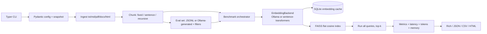

# embedbench

**Benchmark embedding models for RAG retrieval on your own documents, entirely locally.**

`embedbench` ingests a folder of documents, builds a retrieval evaluation set, embeds
and indexes your corpus with several models, and compares accuracy, latency, tokens,
memory and cost-equivalent. It runs against a local Ollama server or local Hugging Face
sentence-transformers models, with no cloud evaluation service and no API keys required.

- **Bring your own corpus:** `.txt`, `.md`, `.pdf`, `.docx`, `.html`.
- **Bring your own queries or generate them:** JSONL eval sets, or synthetic
  questions from a local Ollama LLM with quality filtering.
- **Compare fairly on one machine:** per-model FAISS indexes, exact cosine retrieval,
  cold/warm timings, cache-aware throughput, token counts and memory sampling.
- **Get an answer:** console tables, JSON/CSV, and a self-contained HTML report with
  charts and accuracy-first / speed-first / balanced recommendations.

Status: `0.1.0`, beta. Python 3.10+. MIT licensed.

---

## Table of contents

1. [Why this exists](#why-this-exists)
2. [Architecture](#architecture)
3. [Install](#install)
4. [Quickstart](#quickstart)
5. [CLI reference](#cli-reference)
6. [Configuration reference](#configuration-reference)
7. [Evaluation sets](#evaluation-sets)
8. [Metrics and report interpretation](#metrics-and-report-interpretation)
9. [Sample output](#sample-output)
10. [Adding a custom backend](#adding-a-custom-backend)
11. [Reproducibility and caching](#reproducibility-and-caching)
12. [Project layout](#project-layout)
13. [Tests](#tests)
14. [Known limitations](#known-limitations)
15. [Troubleshooting](#troubleshooting)
16. [Design decisions and trade-offs](#design-decisions-and-trade-offs)
17. [License](#license)

---

## Why this exists

Generic embedding leaderboards (MTEB and friends) measure models on public benchmarks
that may look nothing like your documents. The model that wins on a leaderboard can lose
on your product manuals, support tickets or internal wiki. Retrieval quality also depends
on chunking, query style, top-k, hardware and cold-start behavior.

`embedbench` makes the local loop small and explicit:

1. Point it at a folder.
2. Use a hand-written eval set or generate one from your own chunks.
3. Run every model through the same chunks, the same queries and the same metrics.
4. Keep the config, raw results and environment snapshot for later comparison.

It is intentionally not a hosted platform, a distributed benchmark cluster, or an
LLM-agent framework. It is one reproducible command on a laptop or workstation.

---

## Architecture

```text
                     ┌──────────────────────┐
                     │  Typer CLI            │
                     │  run / generate /     │
                     │  report / list-models │
                     └──────────┬───────────┘
                                │  YAML + CLI overrides
                     ┌──────────▼───────────┐
                     │ Pydantic RunConfig    │
                     │ + config.snapshot     │
                     └──────────┬───────────┘
                                │
          ┌─────────────────────┼──────────────────────┐
          │                     │                      │
 ┌────────▼────────┐   ┌────────▼─────────┐   ┌────────▼──────────┐
 │ Document loader  │   │ Chunker          │   │ Eval-set provider │
 │ txt/md/pdf/docx  │   │ fixed/sentence/  │   │ JSONL or Ollama   │
 │ html             │   │ recursive        │   │ synthetic + filter│
 └────────┬────────┘   └────────┬─────────┘   └────────┬──────────┘
          └─────────────────────┼──────────────────────┘
                                │
                     ┌──────────▼────────────┐
                     │ Benchmark orchestrator │
                     │ per model:             │
                     │  backend.load()        │
                     │  tokenize + cache      │
                     │  embed in batches      │
                     │  build FAISS index     │
                     │  run every query       │
                     │  sample RAM/VRAM       │
                     └──────────┬────────────┘
                                │
          ┌─────────────────────┼───────────────────────┐
          │                     │                       │
 ┌────────▼────────┐   ┌────────▼─────────┐   ┌─────────▼────────┐
 │ Metrics          │   │ Timings/resources │   │ Cost + cache      │
 │ Recall/Precision │   │ p50/p95/p99, cold │   │ tokens, index MB, │
 │ MRR/nDCG/Hit     │   │ warm, RAM, VRAM   │   │ hosted equivalent │
 └────────┬─────────┘   └────────┬─────────┘   └─────────┬────────┘
          └─────────────────────┼───────────────────────┘
                                │
          ┌─────────────────────┼──────────────────────────────┐
          │                     │                              │
 ┌────────▼────────┐   ┌────────▼─────────┐          ┌─────────▼─────────┐
 │ Rich console     │   │ results.json      │          │ report.html        │
 │ summary tables   │   │ results.csv       │          │ self-contained     │
 │ recommendation   │   │ queries.csv       │          │ SVG charts, no CDN │
 └──────────────────┘   └──────────────────┘          └────────────────────┘
```

Mermaid version:



A backend is a small class implementing `load()` and `_embed_prepared()`. Batching,
prefixes, validation and L2 normalization live in the base class, so a new provider is
typically under 30 lines.

---

## Install

Requirements:

- Python **3.10+**
- A local machine with enough RAM for your chosen model
- Optional: [Ollama](https://ollama.com/) for Ollama models and synthetic question generation
- For PDFs/DOCX/HTML: `pypdf`, `python-docx`, `beautifulsoup4` (installed with the package)

From this repository:

```bash
python -m venv .venv

# macOS / Linux
source .venv/bin/activate
# Windows PowerShell / cmd
# .venv\Scripts\activate

python -m pip install --upgrade pip
pip install -e ".[dev]"
```

The base install includes `sentence-transformers` and `faiss-cpu`, so it downloads a
CPU PyTorch build and can be a few hundred MB. If you only use Ollama, the heavy
libraries are imported lazily and never loaded.

Check the CLI:

```bash
embedbench --help
embedbench list-models
```

`list-models` shows a curated catalog and marks which Ollama models are installed.
Hugging Face models are downloaded on first use.

### Ollama

Install Ollama from [ollama.com](https://ollama.com/), then:

```bash
ollama serve
ollama pull nomic-embed-text
# optional, for synthetic evaluation questions:
ollama pull llama3.2
```

`embedbench` talks to `http://localhost:11434` by default. Model names are the same
names you use with `ollama run`, for example `nomic-embed-text`,
`mxbai-embed-large`, or `bge-m3`.

### Hugging Face

Any sentence-transformers compatible model works:

```bash
embedbench run \
  --config examples/config.yaml \
  --models hf:BAAI/bge-small-en-v1.5,hf:all-MiniLM-L6-v2
```

The first run downloads model weights to the Hugging Face cache. Gated models require
accepting the model license and `huggingface-cli login`. No key is bundled with this tool.

---

## Quickstart

From the repository root:

```bash
# 1. Compare two local Hugging Face models on the sample corpus.
embedbench run --config examples/config.yaml

# 2. Open the generated report.
#    macOS: open examples/results/report.html
#    Windows: start examples/results/report.html
#    Linux: xdg-open examples/results/report.html
```

The example config uses:

- `examples/docs/` — six sample documents.
- `examples/evalset.jsonl` — 12 hand-written queries with document-level relevance.
- `hf:BAAI/bge-small-en-v1.5` and `hf:all-MiniLM-L6-v2`.
- `top_k: 5`, recursive 600-character chunks with 100 characters of overlap.
- Outputs in `examples/results/`.

Run the same corpus with an Ollama model:

```bash
ollama serve
ollama pull nomic-embed-text

embedbench run \
  --config examples/config.yaml \
  --models hf:BAAI/bge-small-en-v1.5,ollama:nomic-embed-text \
  --top-k 5 \
  --no-progress
```

`--no-progress` is optional; it only hides embedbench's progress bars, not the
download progress printed by Hugging Face itself.

### Generate an eval set from your documents

```bash
ollama serve
ollama pull llama3.2

embedbench generate-evalset \
  --docs examples/docs \
  --output examples/generated-evalset.jsonl \
  --model llama3.2 \
  --max-chunks 12 \
  --questions-per-chunk 1

embedbench run \
  --docs examples/docs \
  --evalset examples/generated-evalset.jsonl \
  --models ollama:nomic-embed-text \
  --top-k 3
```

To generate and benchmark in one command, use a config without `evalset.path` and set
`evalset.auto_generate: true`, or pass `--auto-evalset` with no eval-set path:

```bash
embedbench run \
  --docs examples/docs \
  --models ollama:nomic-embed-text \
  --auto-evalset \
  --evalset-model llama3.2 \
  --top-k 3 \
  --output-dir results/auto
```

An explicit `evalset.path` wins over auto-generation.

### Re-render with another priority

```bash
embedbench report \
  --results examples/results/results.json \
  --priority accuracy \
  --output examples/results/report-accuracy.html
```

`--results` also accepts the output directory. The original JSON and CSV are untouched;
only a new HTML report is written.

### End-to-end command sequence from a fresh checkout

```bash
python -m venv .venv
source .venv/bin/activate               # Windows: .venv\Scripts\activate
python -m pip install --upgrade pip
pip install -e ".[dev]"
embedbench list-models
embedbench run --config examples/config.yaml --no-progress
embedbench report --results examples/results --priority speed
pytest
```

---

## CLI reference

### `embedbench run`

```text
embedbench run [OPTIONS]

  --docs, -d PATH           Documents folder (.txt/.md/.pdf/.docx/.html)
  --models, -m TEXT         Comma-separated backend:model specs
  --top-k INT               Chunks retrieved per query (default: config, 5)
  --config, -c PATH         YAML config (default: ./embedbench.yaml if present)
  --evalset PATH            JSONL eval set; wins over synthetic generation
  --auto-evalset/--no-auto-evalset
  --evalset-model TEXT      Ollama LLM used for synthetic questions
  --output-dir, -o PATH     Directory for results.json/results.csv/HTML/log
  --seed INT                Global seed
  --priority TEXT           accuracy | speed | balanced
  --chunking TEXT           fixed | sentence | recursive
  --chunk-size INT          Target chunk size in characters
  --chunk-overlap INT       Overlap in characters
  --batch-size INT          Batch size for built-in backends
  --cost-per-1m FLOAT       Hosted price per 1M tokens for estimate
  --cache/--no-cache        Enable/disable the embedding cache
  --cache-dir PATH          Cache directory
  --ollama-host TEXT        Ollama base URL
  --progress/--no-progress  Show embedbench progress bars
  --verbose, -v             Debug logging
```

CLI flags override YAML values. Relative paths resolve from the current working
directory, whether they come from YAML or CLI. The output directory is reused between
runs; files with the same names are overwritten, while `run.log` is recreated.

Exit codes:

- `0` — at least one model completed successfully.
- `1` — setup error, no successful model, or a failed report command.
- `130` — interrupted.

If one model fails (for example, a missing Ollama model), the other models still run and
artifacts are still written. The failed model appears in the report with its error.

### `embedbench generate-evalset`

```text
embedbench generate-evalset [OPTIONS]

  --docs, -d PATH           Documents folder
  --output, -o PATH         Destination JSONL (default: evalset.jsonl)
  --config, -c PATH         YAML config
  --model TEXT              Ollama LLM (default: llama3.2)
  --questions-per-chunk INT 1..5
  --max-chunks INT          Deterministic sample of eligible chunks
  --min-question-words INT
  --dedupe-threshold FLOAT  0.5..1.0 sequence similarity
  --chunking / --chunk-size / --chunk-overlap
  --seed INT
  --ollama-host TEXT
  --progress/--no-progress
  --verbose, -v
```

This command only needs Ollama plus the document parsers; it does not load embedding
models. It writes JSONL with `query_id`, `query`, `relevant_doc_ids`, optional `answer`,
`source_chunk_id` and generator metadata. All questions reference the document ID of
their source chunk.

### `embedbench report`

```text
embedbench report [OPTIONS]

  --results, -r PATH        results.json or the run output directory
  --output, -o PATH         HTML path (or a directory)
  --priority TEXT           accuracy | speed | balanced
  --title TEXT              Override report title
  --verbose, -v
```

The console summary is printed, and a fresh `report.html` is rendered from the saved
JSON. This command does not re-run embeddings or queries.

### `embedbench list-models`

```text
embedbench list-models [OPTIONS]

  --ollama-host TEXT        Ollama base URL
  --json                    Emit JSON
```

Lists curated Hugging Face and Ollama models, dimensions, notes, whether Ollama is
reachable, and which Ollama models are installed. It does not download or ping Hugging
Face. `--json` is suitable for scripting.

---

## Configuration reference

Use `--config config.yaml`. If no path is supplied, `./embedbench.yaml` or
`./embedbench.yml` is loaded when present. Unknown keys are rejected so typos are loud.

A complete example is in [`examples/config.yaml`](examples/config.yaml). The defaults
below match the dataclasses/pydantic models in `embedbench/config.py`.

```yaml
docs: ./docs
models:
  - hf:BAAI/bge-small-en-v1.5
  - ollama:nomic-embed-text
top_k: 5
seed: 42
output_dir: ./results
plugins: []

chunking:
  strategy: recursive       # fixed | sentence | recursive
  chunk_size: 800           # characters, >= 100
  chunk_overlap: 120        # characters, < chunk_size
  min_chunk_chars: 80

ingestion:
  extensions: [".txt", ".md", ".markdown", ".pdf", ".docx", ".html", ".htm"]
  recursive: true
  max_file_bytes: 20000000
  skip_dirs: [".git", ".hg", ".svn", ".venv", "venv", "node_modules", "__pycache__", ".embedbench_cache"]

evalset:
  path: null                # JSONL; wins over auto_generate
  auto_generate: false
  ollama_model: llama3.2
  questions_per_chunk: 1    # 1..5
  max_chunks: null          # deterministic sample when set
  min_chunk_chars: 120
  min_question_words: 5
  max_question_words: 40
  dedupe_threshold: 0.85
  max_generation_attempts: 2
  temperature: 0.0
  num_predict: 220
  request_timeout_s: 180

backends:
  ollama:
    host: http://localhost:11434
    batch_size: 32
    timeout_s: 120
    max_retries: 3
    retry_backoff_s: 0.75
    query_prefix: null
    document_prefix: null
    keep_alive: null
  hf:
    device: auto            # auto | cpu | cuda | cuda:0 | mps
    batch_size: 32
    trust_remote_code: false
    cache_folder: null
    local_files_only: false
    max_seq_length: null    # null keeps the model default
    query_prefix: null
    document_prefix: null
  extra: {}                 # options for custom backends

cache:
  enabled: true
  dir: ./.embedbench_cache

report:
  title: "embedbench report"
  priority: balanced        # accuracy | speed | balanced
  cost_per_1m_tokens: 0.02
```

### Top-level

| Key | Default | Meaning |
| --- | --- | --- |
| `docs` | `null` | Folder to ingest. Required for `run` and `generate-evalset` unless passed with `--docs`. |
| `models` | `[]` | List of `backend:model` specs. CLI `--models` accepts a comma-separated string. |
| `top_k` | `5` | Number of chunks retrieved per query. Metrics are reported at this k. |
| `seed` | `42` | Seeds Python/NumPy, synthetic sampling and LLM generation. |
| `output_dir` | `results` | Artifact directory. Reused across runs. |
| `plugins` | `[]` | Dotted module names or `.py` paths that register extra backends. |

### Chunking

| Key | Default | Notes |
| --- | --- | --- |
| `strategy` | `recursive` | `fixed` = character windows; `sentence` = pack sentences; `recursive` = split on paragraphs/newlines/sentences/words then pack. |
| `chunk_size` | `800` | Target maximum characters. Minimum 100. |
| `chunk_overlap` | `120` | Character overlap target. Must be `< chunk_size`. Sentence/recursive overlap snaps to boundaries and may be smaller than requested. |
| `min_chunk_chars` | `80` | Drop shorter chunks, except that a short document always retains one chunk. |

### Ingestion

| Key | Default | Notes |
| --- | --- | --- |
| `extensions` | txt/md/markdown/pdf/docx/html/htm | Case-insensitive; leading dots optional. |
| `recursive` | `true` | Walk subfolders. Hidden files/directories are ignored. |
| `max_file_bytes` | `20000000` | Larger files are skipped with a reason. |
| `skip_dirs` | see example | Directory names skipped anywhere in the subtree. |

HTML parsing removes `script`, `style`, `nav`, `footer`, `noscript`, `svg` and
`template` elements. PDFs use text extraction only; scanned/image PDFs are skipped.
DOCX paragraphs and tables are flattened in document order.

### Eval set and synthetic generation

| Key | Default | Notes |
| --- | --- | --- |
| `path` | `null` | User JSONL. If set, it is used even if `auto_generate` is true. |
| `auto_generate` | `false` | Generate questions with Ollama when no path is set. |
| `ollama_model` | `llama3.2` | Chat/instruct model used to write questions. |
| `questions_per_chunk` | `1` | Ask for up to this many questions per chunk (1–5). Filtering may accept fewer. |
| `max_chunks` | `null` | If set, sample this many eligible chunks deterministically using `seed`. |
| `min_chunk_chars` | `120` | Chunks shorter than this are not used for generation. |
| `min_question_words` | `5` | Lower filter bound. |
| `max_question_words` | `40` | Upper filter bound. |
| `dedupe_threshold` | `0.85` | SequenceMatcher similarity at/above this drops a near duplicate. |
| `max_generation_attempts` | `2` | Retries for invalid JSON per chunk. |
| `temperature` | `0.0` | Passed to Ollama. |
| `num_predict` | `220` | Ollama max generated tokens. |
| `request_timeout_s` | `180` | HTTP timeout for question generation. |

The generator filters questions that do not end with `?`, are too short/long, mention
“this passage/the document”, are generic (“summarize…”, “what is this about”), have no
content words, or are near-duplicates of an accepted question. These are heuristics, not
an LLM judge; review generated sets before treating them as ground truth.

### Backends

`backends.ollama`:

| Key | Default | Notes |
| --- | --- | --- |
| `host` | `http://localhost:11434` | Trailing slash removed. |
| `batch_size` | `32` | Number of chunks sent per `/api/embed` request in benchmarks. |
| `timeout_s` | `120` | Per-request timeout. |
| `max_retries` | `3` | Retries for connection errors, 429 and 5xx. |
| `retry_backoff_s` | `0.75` | Exponential backoff base; capped at 20s per wait. |
| `query_prefix` / `document_prefix` | `null` | Optional text prepended before embedding. |
| `keep_alive` | `null` | Optional Ollama `keep_alive` value, e.g. `10m`. |

`backends.hf`:

| Key | Default | Notes |
| --- | --- | --- |
| `batch_size` | `32` | Passed to sentence-transformers `encode`. |
| `device` | `auto` | CUDA, then Apple MPS, then CPU. |
| `trust_remote_code` | `false` | Only enable for models you trust. |
| `cache_folder` | `null` | Hugging Face cache override. |
| `local_files_only` | `false` | Fail instead of downloading. |
| `max_seq_length` | `null` | Tokenizer/model truncation length. |
| `query_prefix` / `document_prefix` | `null` | Overrides; E5 model names automatically get `query: ` / `passage: ` unless set. |

`backends.extra` holds free-form options for third-party backends. The base class reads
`batch_size`, `query_prefix` and `document_prefix`; the backend can read anything else.

### Cache and report

| Key | Default | Notes |
| --- | --- | --- |
| `cache.enabled` | `true` | Persistent embedding cache. |
| `cache.dir` | `.embedbench_cache` | SQLite database directory. |
| `report.title` | `embedbench report` | HTML title/heading. |
| `report.priority` | `balanced` | Which recommendation is selected by default. |
| `report.cost_per_1m_tokens` | `0.02` | Hosted API price for the cost-equivalent estimate. |

---

## Evaluation sets

JSONL format, one object per line:

```jsonl
{"query_id": "q001", "query": "What is the maximum payload size?", "relevant_doc_ids": ["api.md"], "answer": "5 MB"}
{"query_id": "q002", "query": "How long are records retained?", "relevant_doc_ids": ["security.html"], "category": "retention"}
```

Rules:

- `query` is required and must be non-empty.
- `relevant_doc_ids` is a non-empty list of document IDs.
- Document IDs are paths relative to the `docs` folder, using `/` separators, for
  example `guides/install.md`. Leading `./` and backslashes are normalized.
- `query_id` is optional; generated IDs are `q0001`, `q0002`, … and never collide.
- `answer` is optional. It is stored in the report but not used by retrieval metrics.
- `source_chunk_id` is optional.
- Unknown top-level fields are preserved under `metadata`.
- Every referenced document must exist **and must produce at least one chunk**. This is
  checked before expensive model loading.

Blank lines are ignored. A duplicate query ID is an error; duplicate query text is a
warning because it intentionally double-weights that query.

Auto-generation timing: every eligible chunk is one Ollama generation call. Use
`evalset.max_chunks` (and `--max-chunks` in `generate-evalset`) for a representative
sample. Sampling is seeded and deterministic.

---

## Metrics and report interpretation

All metrics are computed per query, then averaged. Relevance is **binary and
document-level**. Retrieval returns chunks; each chunk maps to its `doc_id`. Duplicate
chunks from the same document are collapsed at their first rank before computing
metrics. `k` is `top_k` from the run.

### Formulas

Let `Rel` be the set of relevant document IDs, `Docs_k` the unique documents in the
top-k ranked list, and `rank_i` the rank of the first relevant document.

```text
Recall@k    = |Rel ∩ Docs_k| / |Rel|
Precision@k = |Rel ∩ Docs_k| / k
MRR@k       = 1 / rank_first_relevant          (0 if none in top-k)
HitRate@k   = 1 if |Rel ∩ Docs_k| > 0 else 0
DCG@k       = Σ_{i=1..k} rel_i / log2(i + 1)
IDCG@k      = Σ_{i=1..min(|Rel|, k)} 1 / log2(i + 1)
nDCG@k      = DCG@k / IDCG@k                   (0 if IDCG is 0)
```

Precision uses `k` as the denominator even when fewer than `k` unique documents are
returned. This is the standard IR definition and makes low-precision runs visible. With
one relevant document and `top_k=5`, the best possible precision is `0.2`.

A relevant document with many chunks can be retrieved several times but counts once; the
extra chunks consume top-k slots, which lowers precision. Chunk-level evaluation is not
implemented by design; document-level relevance matches the usual user question “did we
find the right source?”.

### Latency

- **Query p50/p95/p99** cover all queries and include query embedding plus vector search.
- **Cold query** is the first query. **Warm** percentiles exclude it.
- **Model load ms** is the time spent in `backend.load()`; for HF this is model loading,
  for Ollama it verifies the model exists (actual model warm-up appears in the first
  embedding).
- **Cold embed** is the first uncached embedding batch. **Warm batch** percentiles
  exclude it. With a full cache hit, there is no cold embed measurement.
- **Indexing seconds** includes cache lookups, vector assembly and index construction.
  **Embedding seconds** is only actual embedding calls. `chunks/sec` is corpus size
  divided by indexing seconds, so a warm cache inflates it; check `cache.hit_rate`.
- **Queries/sec** is `n_queries / sum(query_latency)`. It is a reciprocal mean latency,
  not a load test with concurrent users.

### Tokens, cost and resources

- **HF token counts** use the model's own tokenizer, including any query/document prefix,
  truncated to the model's `max_seq_length`.
- **Ollama token counts** are estimates (words + punctuation) because the Ollama REST API
  does not expose the model tokenizer. Reports mark these with `*` and
  `tokens.estimated: true`.
- **Cost-equivalent** = `total_tokens / 1,000,000 × cost_per_1m_tokens`. It is a
  comparison aid, not a bill. Configure the hosted price you actually care about.
- **RAM peak** is process RSS sampled every 50 ms (PSUtil). It includes the model for HF.
  For Ollama the model lives in the server process, so `model_resident_mb` and VRAM come
  from `/api/ps` and are resident sizes, not sampled peaks.
- **VRAM** for HF is PyTorch CUDA peak allocated memory. It is `n/a` on CPU and Apple MPS.
- **Index size** is the serialized size of the in-memory index at report time. Indexes are
  not persisted between runs.

### Recommendation

Three answers are computed, regardless of the selected priority:

- **Accuracy-first:** highest nDCG@k; ties break on recall, then MRR, then p95.
- **Speed-first:** lowest p95 query latency; ties break on nDCG.
- **Balanced:** weighted score after min–max normalization within the run:
  `0.5 × accuracy + 0.3 × speed + 0.2 × cost`, where speed and cost scores are inverted
  (fastest/cheapest = 1). Ties break on nDCG, then name.

The selected priority comes from `report.priority`, `--priority`, or the report command.
Scores are relative to the models and corpus in that run; they are not absolute quality
scores and cannot be compared across runs without care.

### Report files

| File | Contents |
| --- | --- |
| `results.json` | Schema version, run metadata, config, corpus, eval set, per-model metrics/timings/resources/tokens/per-query results, recommendation, artifact paths. |
| `results.csv` | One flat summary row per model, including cold/warm timing, accuracy, cost, cache, RAM and VRAM. |
| `queries.csv` | One row per model/query with metrics, latency, retrieved documents and relevant documents. |
| `report.html` | Self-contained HTML/CSS/JS with six stat cards, recommendation cards, four SVG charts, timing/resource tables, per-query details, environment and config. No network requests. |
| `config.snapshot.yaml` | Exact validated config used for the run, written before benchmarking. |
| `run.log` | Human-readable run log. |
| `evalset.generated.jsonl` | Synthetic eval set, only when auto-generation was used and no path was given. |

The HTML report includes an accuracy-vs-latency scatter plot, grouped retrieval-metric
bars, latency-percentile bars, and a cost-equivalent bar chart. Charts are generated from
the embedded JSON with vanilla JS and inline SVG; opening the file offline works.

---

## Sample output

The following is from the sample corpus (`6` documents, `19` chunks, `12` queries) on a
16-core Windows CPU, CPU-only PyTorch, `--no-cache`, and two Hugging Face models. Timings
are illustrative and depend heavily on hardware, thermal state, model cache and whether
the embedding cache is warm.

### Accuracy

| Model | nDCG@5 | Recall@5 | Precision@5 | MRR@5 | Hit@5 |
| --- | ---: | ---: | ---: | ---: | ---: |
| `hf:BAAI/bge-small-en-v1.5` | 0.969 | 1.000 | 0.200 | 0.958 | 1.000 |
| `hf:all-MiniLM-L6-v2` | 0.969 | 1.000 | 0.200 | 0.958 | 1.000 |

Both models found the correct document for every query. Precision is `0.2` because there
is one relevant document and `k=5`; that is expected, not a bug. A harder corpus and
more queries are needed to separate these models on accuracy.

### Latency, indexing and footprint

| Model | p50 ms | p95 ms | p99 ms | Index s | Chunks/s | Queries/s | Dim | Index MB | Tokens | Cost est. | RAM MB | VRAM MB |
| --- | ---: | ---: | ---: | ---: | ---: | ---: | ---: | ---: | ---: | ---: | ---: | ---: |
| `hf:BAAI/bge-small-en-v1.5` | 102.4 | 114.9 | 118.3 | 4.72 | 4.0 | 9.7 | 384 | 0.028 | 2,463 | $0.000049 | 684.1 | n/a |
| `hf:all-MiniLM-L6-v2` | 53.6 | 58.1 | 58.1 | 2.24 | 8.5 | 18.5 | 384 | 0.028 | 2,463 | $0.000049 | 653.8 | n/a |

### Recommendation

```text
Selected: hf:all-MiniLM-L6-v2 (Balanced)
Best weighted score (1.000) using 50% accuracy, 30% speed and 20% cost-equivalent:
nDCG@5=0.969, p95=58.05 ms, estimated cost $0.000049.
Alternatives: Accuracy-first: hf:all-MiniLM-L6-v2 | Speed-first: hf:all-MiniLM-L6-v2

Model                       Acc.  Speed   Cost  Balanced
hf:BAAI/bge-small-en-v1.5  1.000  0.000  1.000     0.700
hf:all-MiniLM-L6-v2        1.000  1.000  1.000     1.000
```

With tied accuracy and cost, the faster model wins the balanced and speed priorities.
On a real corpus you can expect different accuracy trade-offs.

---

## Adding a custom backend

A backend only needs `load()` and `_embed_prepared()`. The base class handles formatting
prefixes, text validation, row/dimension checks, finiteness checks and L2 normalization.
The benchmark runner batches calls to `batch_size`.

Create `my_backend.py`:

```python
from __future__ import annotations

import numpy as np

from embedbench.backends import register_backend
from embedbench.backends.base import EmbeddingBackend


@register_backend("constant")
class ConstantBackend(EmbeddingBackend):
    """A deliberately simple backend; replace the vector with your provider call."""

    backend_name = "constant"

    def load(self) -> None:
        self.embedding_dimension = 8

    def _embed_prepared(self, texts: list[str]) -> np.ndarray:
        return np.ones((len(texts), self.embedding_dimension), dtype=np.float32)
```

Point a config at it and run:

```yaml
# constant.yaml
docs: ./examples/docs
models: [constant:demo]
plugins: [./my_backend.py]     # or an importable dotted module name

backends:
  extra:
    constant:
      batch_size: 8
```

```bash
embedbench run --config constant.yaml --evalset examples/evalset.jsonl --top-k 3
```

Notes:

- `plugins` entries are either dotted modules or paths to standalone `.py` files
  (resolved from the current working directory). For multi-file plugins, install the
  package or put it on `PYTHONPATH` and use a dotted module name.
- Backends can override `count_tokens()`, `runtime_metadata()`, `close()`,
  `reset_peak_memory()` and `cache_namespace`. The default token counter is a documented
  heuristic.
- If your provider needs prefixes, pass `query_prefix`/`document_prefix` in
  `backends.extra`, or override `prepare_queries`/`prepare_documents`.
- For distribution, expose an entry point:
  ```toml
  [project.entry-points."embedbench.backends"]
  mybackend = "my_package.backend:MyBackend"
  ```
  The entry point name is the registry name used in `models`.

The interface is intentionally small: `load`, embedding, optional token counting and
metadata. There is no service framework to learn.

---

## Reproducibility and caching

Every run writes `config.snapshot.yaml`, environment versions, platform, CPU/RAM, seed,
corpus stats and the full JSONL examples used. Seeds are applied to Python/NumPy and to
synthetic sampling. LLM calls use `temperature` and per-attempt seeds.

Embedding results are cached in SQLite under
`.embedbench_cache/embeddings.sqlite3` by default:

```text
cache key = (backend namespace, SHA-256(raw chunk text))
namespace = backend + model + prefix instructions + backend-specific identity
```

The cache stores float32 vectors and text hashes, not the raw chunk text. It never caches
query embeddings, and it is keyed by model, not by corpus path, so moving a corpus keeps
the cache useful. Changing prefixes, HF `max_seq_length`, or the Ollama host produces a
new namespace.

To force a cold run:

```bash
embedbench run --config examples/config.yaml --no-cache
```

To clear the cache, delete the cache directory. A model revision fetched from Hugging
Face is not part of the cache key; if a model is updated in place, clear the cache or
pin your own local model directory. Timings are also affected by page cache, CPU
frequency, thermal throttling, other processes and whether the model was just loaded.

---

## Project layout

```text
embedbench/
├── embedbench/
│   ├── __init__.py
│   ├── __main__.py
│   ├── cli.py                 # Typer commands and CLI overrides
│   ├── config.py              # Pydantic config, YAML loading, snapshots
│   ├── errors.py
│   ├── logging_utils.py
│   ├── models.py              # Document, Chunk, EvalExample, ModelSpec, tokens
│   ├── utils.py               # hashing, atomic writes, seeds, percentiles
│   ├── ingest.py              # discovery + txt/md/pdf/docx/html loaders
│   ├── chunking.py            # fixed / sentence / recursive chunkers
│   ├── evalset.py             # JSONL validation + Ollama question generation
│   ├── ollama_client.py       # retries, timeouts, legacy embed fallback
│   ├── cache.py               # SQLite embedding cache
│   ├── index.py               # FAISS flat cosine + NumPy fallback
│   ├── metrics.py             # Recall/Precision/MRR/nDCG/Hit
│   ├── resources.py           # RAM sampling and environment metadata
│   ├── catalog.py             # curated model list + Ollama inventory
│   ├── benchmark.py           # orchestrator
│   ├── report.py              # Rich, JSON/CSV, recommendations, HTML
│   ├── py.typed
│   └── backends/
│       ├── __init__.py
│       ├── base.py            # EmbeddingBackend interface
│       ├── hf.py              # sentence-transformers backend
│       ├── ollama.py          # Ollama REST backend
│       └── registry.py        # registration, plugins, entry points, factory
├── examples/
│   ├── config.yaml
│   ├── evalset.jsonl
│   └── docs/                  # sample overview/install/API/billing/security/errors
├── tests/
│   ├── conftest.py
│   ├── fake_backend.py        # deterministic hashing backend for tests
│   ├── test_backends.py
│   ├── test_chunking.py
│   ├── test_evalset.py
│   ├── test_ingest.py
│   ├── test_metrics.py
│   ├── test_report.py
│   └── test_smoke.py
├── pyproject.toml
├── README.md
├── LICENSE
└── .gitignore
```

---

## Tests

```bash
pip install -e ".[dev]"
pytest
pytest --cov=embedbench --cov-report=term-missing
```

The suite runs offline:

- Chunkers: fixed windows, overlap, sentence boundaries, recursive packing, coverage,
  validation, short-document fallback and determinism.
- Metrics: hand-computed Recall/Precision/MRR/nDCG/Hit, deduplication, missing results,
  k validation and aggregation.
- Backends: interface prefixes/normalization/validation, registry, plugin loading,
  Ollama retries/timeouts/legacy fallback/missing models, mocked sentence-transformers
  and tokenizer counts.
- Ingestion: Markdown/HTML/TXT, real DOCX, mocked PDF, filters, binary files and empty
  corpora.
- Evalsets: valid/invalid JSONL, IDs, metadata, question parsing, vague/duplicate filters
  and deterministic chunk sampling.
- Report: recommendation changes with priority, XSS/script-breakout escaping, standalone
  HTML, CSV/JSON artifacts.
- Smoke: CLI end-to-end with a tiny corpus, warm cache, report command, a failing model
  alongside a successful one, and the mocked `generate-evalset` command.

No Ollama server or Hugging Face download is required for the tests; the fake hashing
backend exercises the real cache, FAISS, metrics and report pipeline.

---

## Known limitations

- **Document-level relevance only.** `relevant_doc_ids` cannot point at a specific chunk.
  A document with many chunks gets one credit but can consume multiple top-k slots.
- **Synthetic questions are not verified.** Filters catch obvious vagueness and
  duplicates, but a local LLM can still write unanswerable or trivial questions. Review a
  sample and prefer your own JSONL for decisions.
- **Ollama tokens are external estimates.** The REST API returns embeddings, not a
  tokenizer. Cost-equivalent for Ollama is approximate and flagged in results.
- **Ollama VRAM is resident size, not peak** (from `/api/ps`). Ollama server RAM is not
  sampled by the benchmark process. HF CUDA peak uses PyTorch allocator stats; CPU/MPS
  have no VRAM number.
- **Exact search, not ANN.** FAISS `IndexFlatIP` is exact and simple, but memory and
  search cost grow linearly with corpus size. This is aimed at thousands to low hundreds
  of thousands of chunks. Sharded/IVF/HNSW indexes are future work.
- **Indexes are not persisted.** They are built and measured in memory for each model;
  only their serialized size is reported.
- **Latency is single-process and single-request.** Query throughput is not a concurrency
  benchmark. GPU batch throughput and server queueing under load are not modeled.
- **Chunk overlap is approximate for semantic strategies.** Sentence/recursive chunkers
  snap to boundaries, so overlap can be slightly less than `chunk_overlap`. A single
  oversized sentence is hard-split mid-word as a fallback.
- **PDF OCR is not included.** Scanned PDFs yield no text and are skipped with a warning.
  DOCX tables are flattened to ` | `-separated text; complex layouts lose structure.
- **HTML boilerplate removal is heuristic.** `nav`, `footer`, `script`, `style` and
  similar elements are removed, which could remove intentionally relevant text.
- **Cost is one configured price.** A single `cost_per_1m_tokens` is applied to every
  model; provider-specific prices, query/embedding price differences and discounts are
  out of scope.
- **Cache freshness is manual.** The cache key includes model name and format-affecting
  options, but not a Hugging Face revision or a local weight file hash.
- **Seeds do not guarantee bit-identical results** across hardware, PyTorch/FAISS
  versions, or Ollama model updates. They do make sampling and question filtering
  deterministic.
- **Single-machine, single-user tool.** No authentication, multi-tenancy, remote workers,
  scheduler or database backend. Reports contain document paths and queries; treat them
  as local data.
- **Plugins execute arbitrary Python.** Only load plugins you trust.
- **The synthetic filter is English-centric** (English stopwords and question patterns).
  Retrieval itself is model-dependent and can be multilingual; question generation and
  filtering may need adjustments for other languages.

---

## Troubleshooting

### `Model 'x' is not installed in Ollama`

```bash
ollama pull x
```

`embedbench list-models` shows installed Ollama models and the exact pull command.

### `Could not reach Ollama at ...`

Start the server:

```bash
ollama serve
```

Check `backends.ollama.host` / `--ollama-host`. Remote Ollama works if the port is
reachable; TLS/reverse-proxy auth is not implemented.

### HF model download or authentication errors

- Check the exact model ID on Hugging Face.
- Gated model: accept the license and run `huggingface-cli login`.
- Offline machine: pre-download with `huggingface-cli download <model>` and set
  `backends.hf.local_files_only: true`.
- `trust_remote_code` is disabled by default; enable only for trusted model repositories.

### `The Hugging Face backend requires sentence-transformers and torch`

```bash
pip install "sentence-transformers>=3.0"
```

### `FAISS unavailable; using slower NumPy exact search`

The NumPy fallback is correct and produces the same metrics. Install a compatible
`faiss-cpu` wheel for the faster index. On unusual platforms without a wheel, use conda
or the NumPy fallback.

### No documents / no text

- Check the folder and extensions.
- PDFs may be scans without a text layer; OCR them first.
- Binary `.txt` files with NUL bytes are rejected.
- Check `skipped_files` in `results.json` and the log for parse errors.

### Windows Hugging Face symlink warning

This is a cache-storage warning, not an embedbench failure. It is harmless; enabling
Windows Developer Mode or setting `HF_HUB_DISABLE_SYMLINKS_WARNING=1` silences it.

### Cache is making timings look too fast

That is expected. `results.json` contains `cache.hit_rate`, and the console prints a
cache reuse line. Use `--no-cache` for cold indexing numbers, and delete the cache
directory for a clean start.

### Generated questions are rejected

Try a stronger instruct model (`qwen2.5:7b`, `llama3.1:8b`), larger chunks, a lower
`min_question_words`, or a higher `max_chunks`. Run with `--verbose` to see per-chunk
generation diagnostics in the log.

---

## Design decisions and trade-offs

- **Local-first, two strong backends.** Ollama is a simple HTTP integration; HF uses
  sentence-transformers with the model's own tokenizer. Keeping both behind one interface
  avoids provider-specific benchmark code.
- **FAISS flat index with NumPy fallback.** Exact cosine is deterministic, requires no
  training, and is appropriate for local corpora. It does not scale to millions of chunks.
  The fallback keeps the tool usable where FAISS wheels are unavailable.
- **Document-level relevance, not chunk-level.** This matches the practical question
  “was the right source retrieved?” and avoids requiring users to label individual chunks.
  It makes precision sensitive to chunk count, which the report explains.
- **Synthetic set generation plus hard filters.** LLM-generated questions are useful, but
  unvalidated ones can flatter a model. The filters are transparent and deterministic;
  human-written JSONL remains the gold standard.
- **SQLite cache rather than one file per vector.** One file per embedding becomes
  unwieldy at thousands of chunks; SQLite gives atomic writes, compact storage, and no new
  dependency.
- **Measure what is visible.** Cold load, first-batch/first-query timings, cache hits,
  tokenizer counts, peak process RSS, GPU allocator peak, resident Ollama sizes and
  serialized index size are all reported; no single “score” hides the trade-offs.
- **Report as one portable file.** Inline CSS/JS and SVG charts mean no CDN, no server,
  no PII leaking to a chart library, and a report you can email or archive.
- **Strict config and graceful degradation.** Pydantic rejects typos, but a broken file or
  one failed model does not discard the run. Errors are actionable (`ollama pull`,
  `ollama serve`, install extras).
- **Heavy dependencies are declared.** The base install includes PyTorch-backed
  sentence-transformers to make the HF path work out of the box. Ollama-only users still
  pay the install cost, but no model is loaded at runtime. A future split could move HF
  into an extra.
- **No server, auth, or scheduler.** Those are a different product. The CLI, cache and
  artifacts are easy to script in CI or a local workflow.

---

## License

MIT. See [LICENSE](LICENSE).
